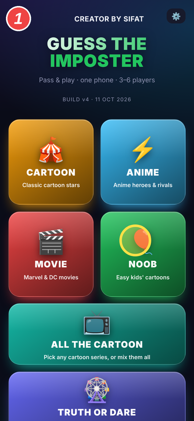
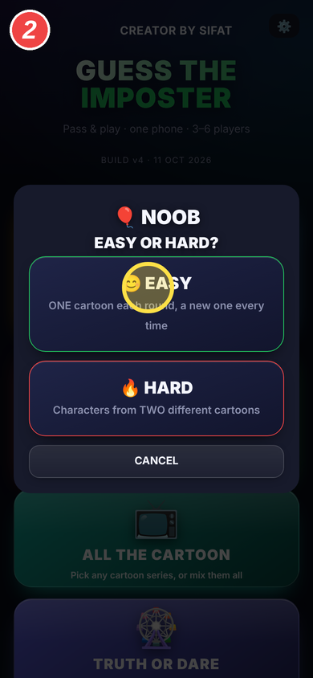
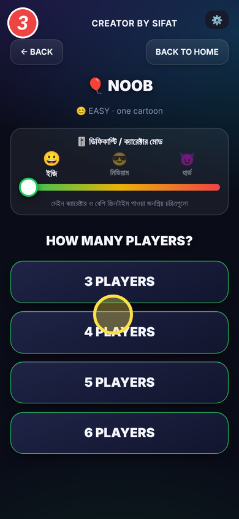
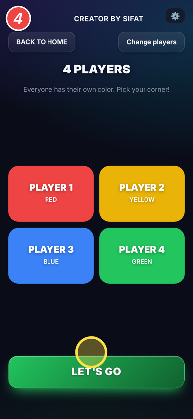
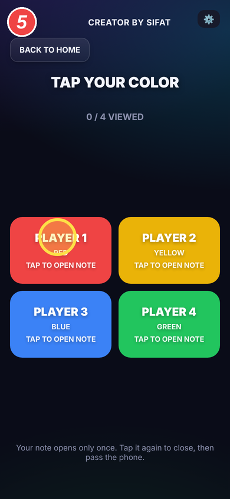
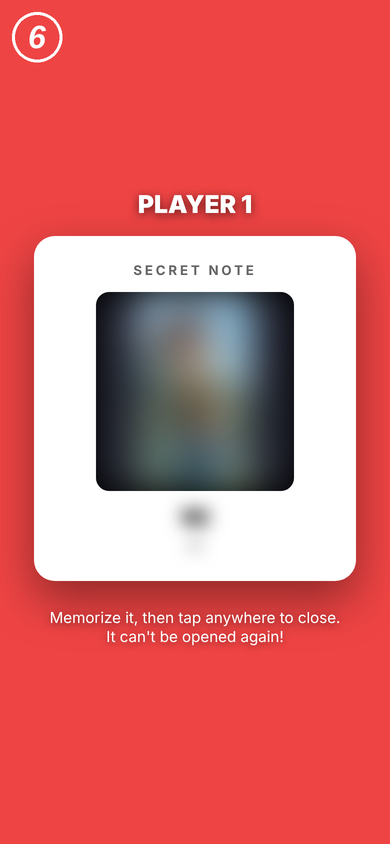
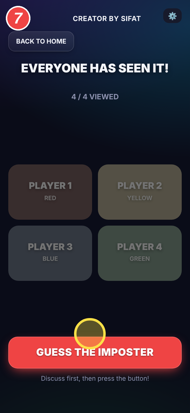
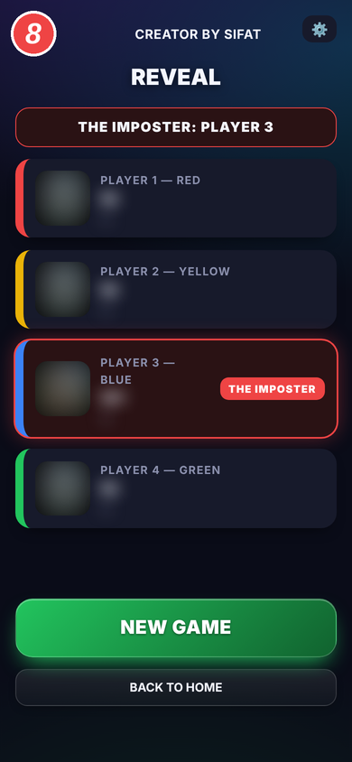
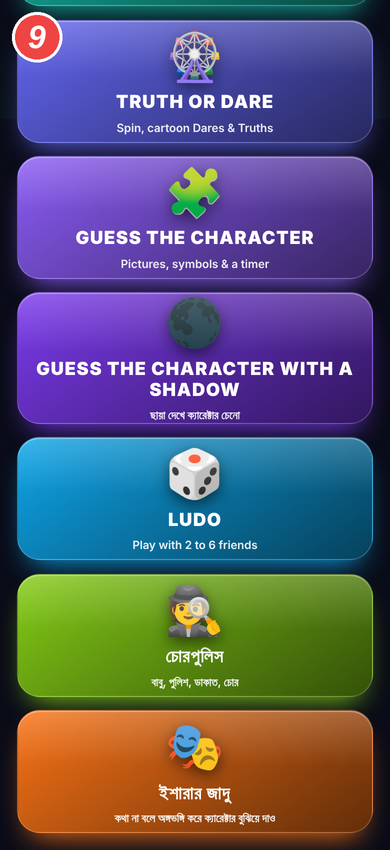

## ⬇️ ডাউনলোড / Download (Android APK)

### 👉 [**Guess-the-Imposter.apk ডাউনলোড করুন**](https://github.com/sx6300317-cloud/GuessThe-Imposter/releases/latest/download/Guess-the-Imposter.apk)

# Guess the Imposter 🕵️

**Guess the Imposter** — a free pass-and-play party game for 3–6 players on one phone. Cartoon, anime, Marvel/DC and more characters. Everyone sees the same character except the imposter — find them!

Made by **Sifat**. Works offline as an Android app.

## 📲 ইনস্টল করার নিয়ম / How to install

1. উপরের ডাউনলোড লিংকে ক্লিক করে ফাইলটা নামান।
2. ফাইলটা খুলে *Install* চাপুন (বলা হলে "এই সোর্স থেকে ইনস্টল করার অনুমতি" দিন)।
3. অ্যাপ খুলে খেলুন!

## 🎮 কীভাবে খেলবেন / How to play (ধাপে ধাপে)

এক ফোন, ৩–৬ জন বন্ধু। সবাই একই ক্যারেক্টার পায়, শুধু ইম্পোস্টার আলাদা একটা পায় আর সে নিজেও জানে না! কথা বলে তাকে ধরুন।

<table>
<tr>
<td width="200"></td>
<td><b>ধাপ 1: ক্যাটাগরি বেছে নিন</b>  হোম স্ক্রিনে হলুদ গোল চিহ্নে ট্যাপ করে একটা ক্যাটাগরি বাছুন: Cartoon, Anime, Movie, Noob, All the Cartoon, Truth or Dare ইত্যাদি। Tap a category on the home screen (Cartoon, Anime, Movie, Noob…).</td>
</tr>
<tr>
<td width="200"></td>
<td><b>ধাপ 2: EASY নাকি HARD</b>  EASY: সবার একই ক্যারেক্টার, ইম্পোস্টারের আলাদা। HARD: ক্যারেক্টার দুটো আলাদা কার্টুন থেকে আসে। EASY or HARD — pick the difficulty.</td>
</tr>
<tr>
<td width="200"></td>
<td><b>ধাপ 3: কতজন খেলবে</b>  ৩ থেকে ৬ জনের মধ্যে খেলোয়াড় সংখ্যা বাছুন। এখানে 4 PLAYERS-এ ট্যাপ করা হয়েছে। Choose 3 to 6 players.</td>
</tr>
<tr>
<td width="200"></td>
<td><b>ধাপ 4: LET'S GO চাপুন</b>  নিচের সবুজ LET'S GO বাটনে ট্যাপ করলে খেলা শুরু হবে। Tap the green LET'S GO button.</td>
</tr>
<tr>
<td width="200"></td>
<td><b>ধাপ 5: নিজের রঙে ট্যাপ করুন</b>  প্রত্যেক খেলোয়াড়ের একটা রঙ আছে। একজন একজন করে নিজের রঙে (TAP TO OPEN NOTE) ট্যাপ করুন। অন্যরা অন্যদিকে তাকিয়ে থাকবে। Each player taps their own colour, one at a time, while the others look away.</td>
</tr>
<tr>
<td width="200"></td>
<td><b>ধাপ 6: গোপন নোট দেখুন</b>  ছবির কার্ডে আপনার ক্যারেক্টার দেখা যাবে (এখানে ছবি ঝাপসা করা)। মুখস্থ করে স্ক্রিনের যেকোনো জায়গায় ট্যাপ করে বন্ধ করুন, তারপর ফোন পরের জনকে দিন। নোট একবারই খোলা যায়! Memorise your character, tap anywhere to close, then pass the phone. A note opens only once!</td>
</tr>
<tr>
<td width="200"></td>
<td><b>ধাপ 7: আলোচনা করে GUESS চাপুন</b>  সবার দেখা শেষ হলে "EVERYONE HAS SEEN IT!" আসবে। প্রথমে সবাই নিজের ক্যারেক্টার নিয়ে কথা বলুন, কে আলাদা বোঝার চেষ্টা করুন। তারপর লাল GUESS THE IMPOSTER বাটনে ট্যাপ করুন। Discuss first, then press GUESS THE IMPOSTER.</td>
</tr>
<tr>
<td width="200"></td>
<td><b>ধাপ 8: রিভিল: ইম্পোস্টার কে?</b>  উপরে দেখাবে ইম্পোস্টার কোন খেলোয়াড়, আর নিচে সবার ক্যারেক্টার। আবার খেলতে NEW GAME চাপুন। The reveal shows who the imposter is. Tap NEW GAME to play again.</td>
</tr>
<tr>
<td width="200"></td>
<td><b>ধাপ 9: আরও সেকশন</b>  হোম স্ক্রিন স্ক্রল করলে আরও মজার সেকশন পাবেন: Truth or Dare, Guess the Character, Shadow, Ludo, চোরপুলিস, ইশারার জাদু। Scroll the home screen for more sections.</td>
</tr>
</table>

## 🌐 Play in browser

Download `Guess the Imposter.html` from this repository and open it in any browser — everything is in that single file.

## Features

- Pass-and-play, one phone, 3–6 players
- Cartoon, Anime, Marvel & DC, Noob, All the Cartoon, Truth or Dare
- Shadow mode, Bengali / English / Hindi / Urdu
- Works fully offline

*Keywords: guess the imposter, imposter game, guess the imposter github, party game apk, cartoon guessing game, android offline game.*
